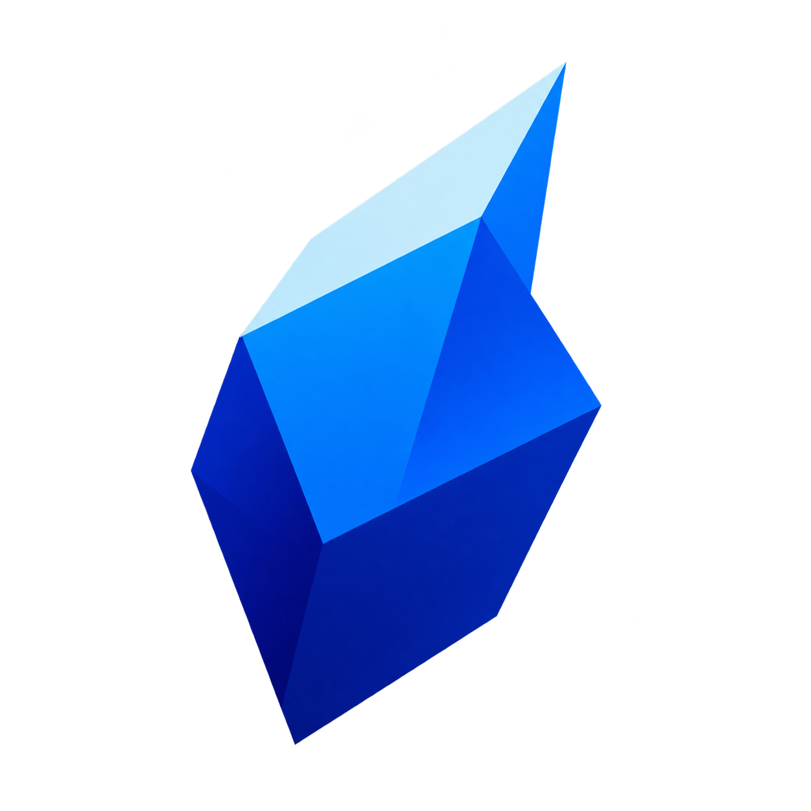

<p align="center"></p>

# Glass

A local Windows notebook for math, physics, chemistry, and biology, with editable equations, scientific diagrams, offline graphing, and PDF export.

Glass is **100% AI-coded**: all Glass-specific application code was generated by AI under human direction. Third-party libraries and the Electron runtime retain their own authorship and licenses.

## Download

Download **Glass v4.2.5** from [GitHub Releases](https://github.com/Book-cpu550/Glass/releases/tag/v4.2.5). Use the Windows installer, or extract the complete portable ZIP and run Glass.exe. Verify downloads against SHA256SUMS.txt. The installer is unsigned; no publisher signing certificate was available.

See [what’s new in v4.2.5](docs/RELEASE-v4.2.5.md) for the upgrade details.

## Features

- **Python coding notes:** on-paper Python editing, bundled CPython 3.15.2 with core standard-library support, optional stdin, Run/Stop and console output, exact `.py` exports, and Python-aware AI review. Third-party packages are not bundled.

- **Note type chooser and MATLAB-compatible notes:** New note or Ctrl N prompts for a blank document, JavaScript, MATLAB, or Python coding note. MATLAB notes execute locally through bundled GNU Octave 11.3.0, with Run/Stop, console output, plot images, MATLAB-aware AI help, and exact `.m` exports. MATLAB-specific toolboxes may differ or be unavailable.

- **JavaScript coding notes:** New note → JavaScript coding note; indented code editing, Run/Stop, an output console, and offline runnable HTML plus JavaScript exports. Standard JavaScript runs in an isolated worker with execution/output limits; Node/DOM APIs and external packages are unavailable in the playground.

- **Documents:** multiple notebooks; editable note titles; mixed prose and editable inline/display equations; fonts, sizes, headings, lists, subscripts, and tables with resizing, headers, colors, and merged cells. New notes open as blank documents.
- **Math:** matrices with custom dimensions, editable bounds, integrals, evaluation brackets, accents, vectors, and advanced symbols. Search 258 offline math references from algebra through multivariable calculus, differential equations, and linear algebra.
- **Chemistry:** 27 chemistry notation entries, 129 offline references, a complete 118-element periodic table, and six offline study charts; local 2D structures/reaction diagrams, atom/charge balance checks, isomer selection, and generated 3D molecular conformers from bundled compounds, formulas, or SMILES. Qualified VSEPR shape panels distinguish model colors from substance appearance; inline molecule viewers inspect atoms, connected bonds, distances, and angles.
- **Biology:** 60 offline references and 16 biology notation entries; DNA/RNA analysis, reverse complements, transcription, translation, GC content, scientific names, and editable Punnett tables. Diagram animal/plant cells with 19 available parts per type, pedigrees, phylogenies, pathways, and microscope images with calibrated scale bars. Inserted diagrams offer clickable explanations, locally editable annotations, and a hide-labels quiz mode.
- **Drawing and graphs:** pen/eraser, local editable figures, Cartesian/polar/3D surfaces, and 2D/3D vector fields with formatted i/j/k notation, independent ranges, arrow normalization, and quality controls. Inline viewers rotate/pan/zoom and save the chosen view for PDF output while retaining ink. Equation sliders, linked note equations, and Cartesian point/slope/root/intersection/area inspection work locally.
- **Physics:** 64 symbol entries and 48 reference entries; a separate Physics graphing tab for 2D/3D projectile/falling-object motion, quadratic drag or vacuum comparison, wind/crosswind, numerical flight/height/range/speed/energy results, and playback with time scrubbing and normalized velocity/net-force arrows.
- **Navigation and study:** `/` insertion at the cursor, search across notes and imported files from the sidebar, heading outline/folding, focus mode, selection formatting, and local flashcards from text/equations/diagrams with scheduled reviews. [Interactive notes guide](docs/INTERACTIVE-NOTES.md).
- **Study assistance:** a note-aware AI helper, reviewed photo-to-text transcription, lightweight offline grammar checks, optional AI grammar review, and reviewable AI reference imports by name or public HTTPS text/HTML link. Reference libraries support search, filters, favorites, custom entries, editable formula insertion, and source links.
- **Writing, research, and recovery:** offline English spelling/grammar bubbles with Accept/Dismiss and a personal dictionary; MLA source forms, optional URL/DOI metadata lookup, locally retained form drafts, in-text citations, and Works Cited pages; numbered scientific cross-references, separate searchable Math/Biology/Chemistry/Physics Symbols palettes with a Greek-letter picker, folders/tags/pins/backlinks, portable local backups, and reviewed AI edits with explicit context controls.
- **Local workflow:** autosave, note/diagram search, substantial-edit history snapshots, recovery, archiving, deletion to the Recycle Bin, reviewed PDF and Markdown/LaTeX/text import, read view, print preview/layout controls, and PDF export preserving text, formatting, equations, tables, and figures.

- **Collaboration:** private edit/view invitations, optional username/password accounts, concurrent document and title editing, collaborator cursors/selections, participant chips, connection and pending-delivery indicators, local copies, offline edits with reconnect/merge, and host revocation. Configured automatic internet sharing uses the Cloudflare free-tier-compatible service, retaining encrypted documents while the owner is offline. Accounts keep encrypted shared-document shortcuts accessible across devices. Free quotas apply; local-only sharing remains an option. See [sharing setup and limits](docs/COLLABORATION.md).

## Offline use, AI, and privacy

Core editing, bundled references, drawings, math graphing, local chemical structures/3D conformers, biology tools, grammar quick checks, saving, and PDF export work offline. Unknown compound names may require SMILES or optional PubChem lookup.

AI features require internet access and **your own installed, signed-in Codex**. Glass does not include the developer's account, credentials, API keys, or personal notes. AI requests send the previewed note/selection/question context, any enabled conversation history, or chosen photo to OpenAI when requested; PubChem lookup sends unknown chemical names/formulas only when enabled. Optional citation lookup contacts the entered public page and may query Crossref with its DOI; update checks contact the public GitHub release API on request. Glass follows the local Codex authentication configuration and inherits its launch environment; it does not force a specific authentication method. Review AI and photo-transcription results before inserting them.

Notes, local helper history, custom references, favorites, settings, and drafts are stored in `%APPDATA%\Glass`. There is no automatic cloud synchronization. Sharing starts only when requested; a configured relay stores encrypted document updates and hashed access capabilities, not plaintext document content or document decryption keys. Optional accounts store a username, salted verifier, necessary security records, and encrypted shortcuts. Invite links contain document keys. Locally saved invitations use Windows-protected storage. Relay traffic necessarily exposes connection metadata such as IP addresses to its operator. A local search index and on-demand note loading avoid loading all note bodies at startup after the initial indexing pass. Open editors are kept in a bounded cache. Chemical conformers and biological diagrams are generated/schematic representations; reaction tools do not predict products.

## Build and run

Use a current Node.js version supported by the pinned dependencies on Windows:

```powershell
npm ci
npm run build
npm start
```

```powershell
npm test
npm run package
npm run installer
```

The package step builds the editor and preserves Electron's original launcher bytes. The source includes vendored Plotly/OpenChemLib package archives and the MathLive accent-editing build patch.

Validation includes unit tests and application smoke checks for writing, recovery, navigation, citations, and concurrent sharing. See the local release notes for the latest verified counts. Live AI, PubChem, and Crossref requests were not exercised by automated checks. App smoke scripts are in `test/*-smoke.cjs`; each uses temporary local data.

See [cloud sharing, accounts, and persistence](docs/CLOUD_SHARING.md).

See the [user guide](docs/USER_GUIDE.md) for detailed controls and recovery behavior, [signing information](docs/SIGNING.md), and [third-party notices](THIRD_PARTY_NOTICES.md) for dependency attribution.

## License

Glass-specific source is provided under the [MIT License](LICENSE). Third-party components retain their respective licenses.
